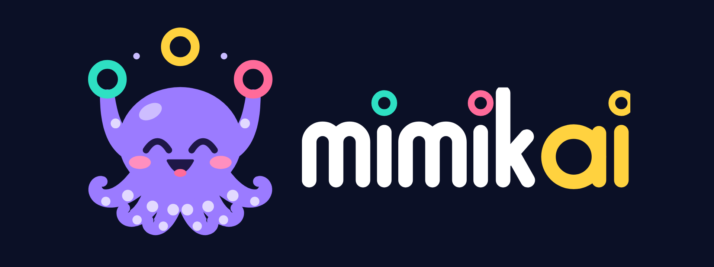

# Mimikai brand

**Mimikai** is both apps and the class pet: a kawaii octopus that juggles three rings. Say *mi-mi-KAI*; children shorten it to *Mimi*.

- **The name.** *Mímica* (Spanish, Portuguese), *mimique* (French) and *mimic* (English): the octopus copies the children and turns into the lesson. The *ai* at the end is highlighted on purpose.
- **The rings.** Each ring is a raised hand the camera follows, the same ring the app draws on a child. Mint is team A (left half of the wall), coral is team B (right half), sun is the projector's light.
- **The suckers** are the tracking dots the phone draws on each child.
- **One logo** for the TV app and the phone app: each store only ever shows one of them.

## Files

| File | Use |
|---|---|
| `mimikai-logo.svg` | The octopus on dark backgrounds (Night, the TV, the apps) |
| `mimikai-logo-paper.svg` | On white: slightly deeper colours, no shine |
| `mimikai-logo-mono.svg` | One colour: stamps, black-and-white worksheets; the face and suckers are cut out |
| `mimikai-wordmark.svg` | The name on dark backgrounds: white letters, *ai* in sun |
| `mimikai-wordmark-paper.svg` | The name on white: ink letters, *ai* in deep sun |
| `mimikai-wordmark-mono.svg` | The name in one colour |
| `mimikai-lockup.svg`, `mimikai-lockup-paper.svg` | Octopus and name side by side |
| `icons/*.svg` | Layouts for the launcher icon, Android adaptive and themed icon, splash, favicon and Fire TV banners |
| `icon-source.png` | The first icon (drawn with Google Gemini for the hackathon), kept for the record |

`scripts/brand-icons.sh` renders `icons/*.svg` into both apps' assets and `banner.png`. Rebuild the native apps afterwards (`scripts/devices.sh <app> --clean`).

## Colours

| Name | On dark | On paper | Role |
|---|---|---|---|
| Mimika Violet | `#9B7BFF` | `#8462F5` | The octopus. Never recoloured. |
| Mint ring | `#2EE0C3` | `#14B89C` | Team A, first i-dot |
| Coral ring | `#FF6B9A` | `#F2557F` | Team B, second i-dot |
| Sun | `#FFD23F` | `#F0A500` | The top ring, the third i-dot and the *ai* |
| Night | `#0B1026` | | The projected wall and the app background |
| Blush | `#FF8FBF` | `#FF85B6` | Cheeks only |
| Ink | `#1E1747` | | Eyes, mouth, wordmark on paper |

## Rules

- Keep the octopus violet on every background; the rings carry the team colours.
- Leave clear space of at least one ring's width around the logo and the wordmark.
- On white use the `-paper` files: sun yellow is weak on white, so the *ai* reads by its shape there.
- Don't stretch, outline, add shadows, or put the logo on busy photos.
- Inside the apps Mimikai may change expression (the happy face is the logo; sparkle eyes when it talks to the class).

## Before launch

- Professional trademark search in the US, Canada, Mexico, Brazil and one Spanish-speaking South American market. Check *mimik* (a Vancouver edge-computing company that markets AI) and the AI voice app *Mimiker*.
- French reads *ai* as *è*: say the name in the Quebec launch material.
- The masters still use strokes and, in the one-colour logo, an SVG mask. Convert them to outlined, merged shapes before sending them to a print shop or embroidery.
